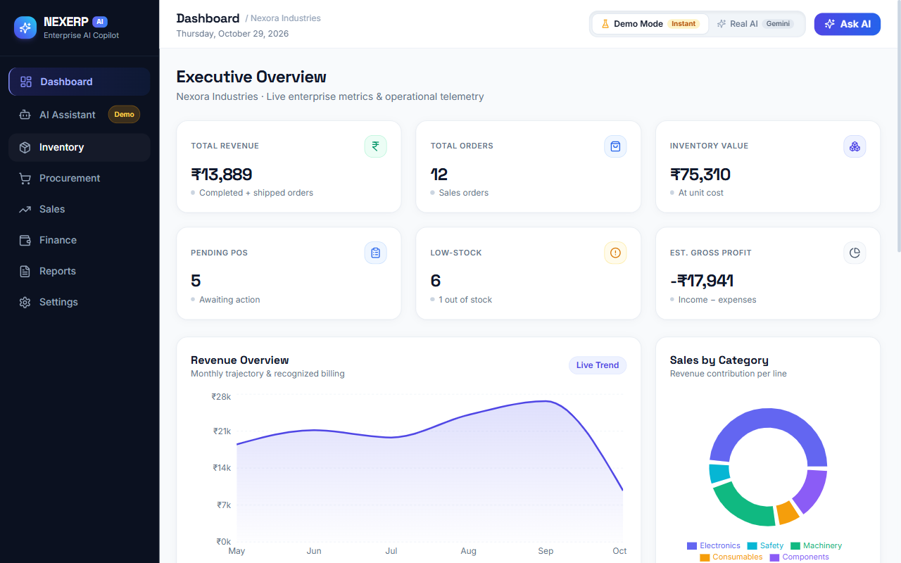
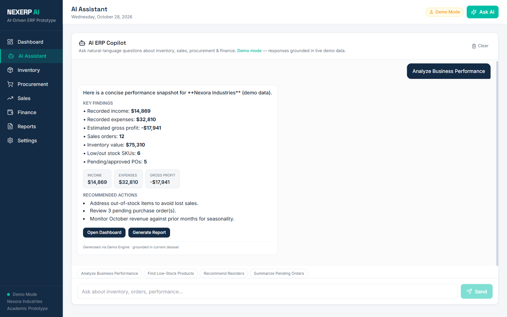
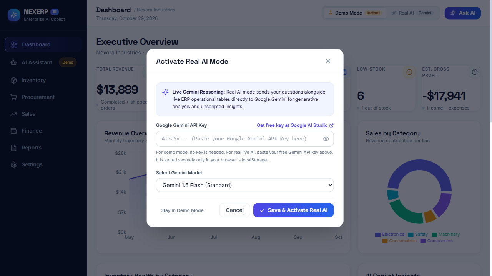
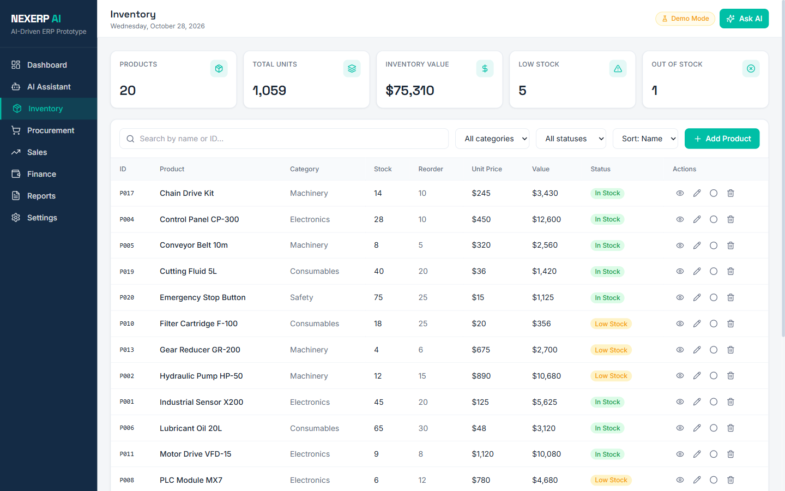
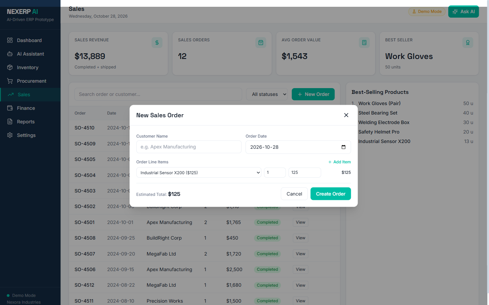
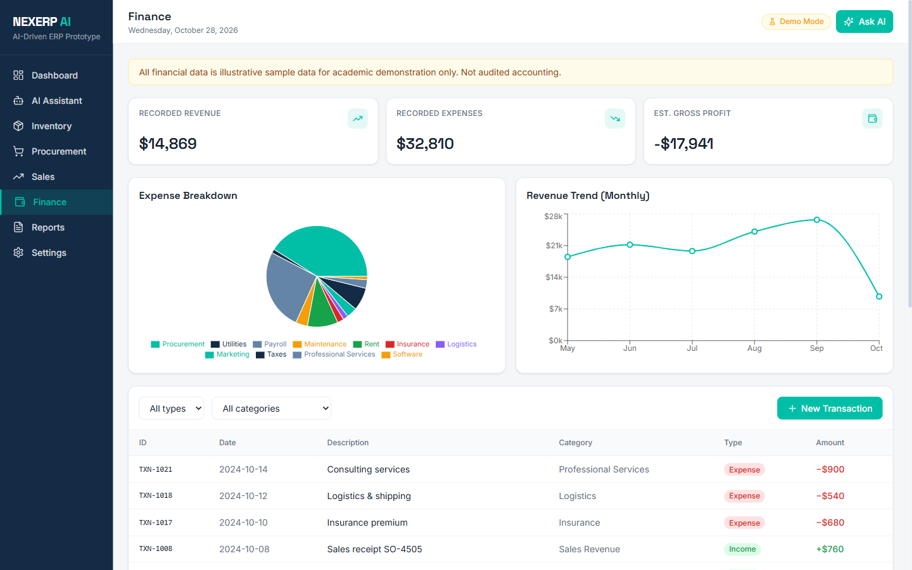
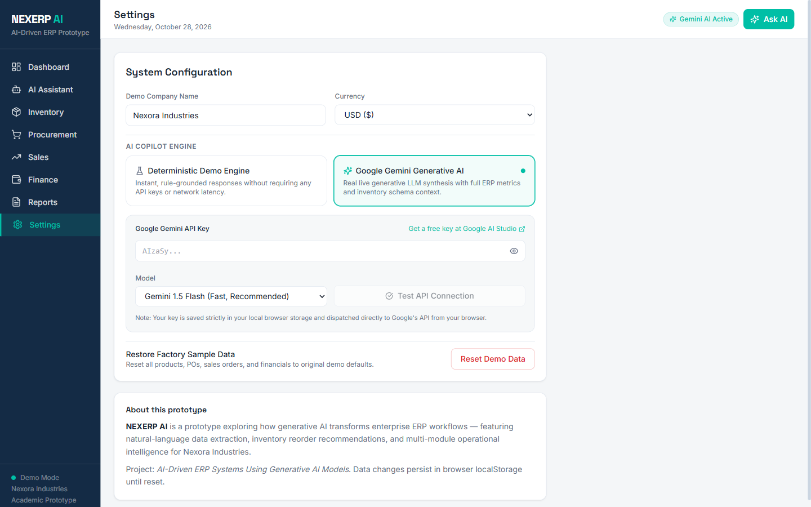
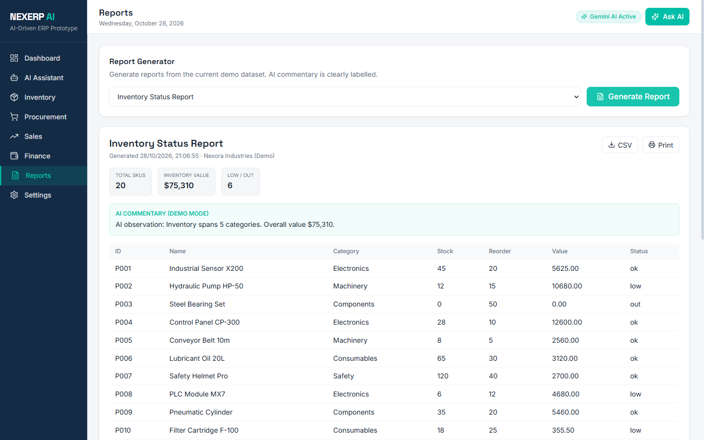

# NEXERP AI — Enterprise Cloud ERP & Dual-Engine AI Copilot

[](LICENSE)
[](https://react.dev/)
[](https://www.typescriptlang.org/)
[](https://vitejs.dev/)
[](https://tailwindcss.com/)
[](https://aistudio.google.com/)

**NEXERP AI** is an enterprise-grade ERP (Enterprise Resource Planning) platform built with React, TypeScript, Tailwind CSS, and Recharts. It features a **Dual-Engine AI Architecture** providing zero-configuration offline deterministic reasoning alongside live, cloud-grounded Generative AI powered by **Google Gemini 2.0 Flash, 1.5 Flash, and 1.5 Pro**.

All metrics, telemetry, ledgers, and transactions default to **Indian Rupees (`₹`)** with seamless multi-currency support (`USD $`, `EUR €`, `GBP £`).

---

## Visual Showcase

### 1. Executive Dashboard (Indian Rupees ₹ Currency & 3-Column Grid)
*Real-time executive metrics, Area trend graphs, Donut category breakdowns, inventory alerts, and instant mode switching.*



### 2. Dual-Engine AI Copilot
*Natural-language enterprise queries grounded in operational telemetry with inline action buttons and deep operational auditing.*



### 3. "Activate Real AI Mode" (Google Gemini Integration)
*Secure in-browser key storage in localStorage with Google AI Studio quick-connect and model selection (Gemini 2.0 Flash / 1.5 Flash / 1.5 Pro).*



### 4. Inventory Management & SKU Control
*Unit prices, reorder levels, stock adjustments, low/out-of-stock badge filtering, and automated SKU valuation.*



### 5. Sales Management & New Order Builder
*Real-time line items calculation, customer directory, best-seller rankings, and order status lifecycle automation.*



### 6. Finance & Treasury
*Income vs. expense ledgers, monthly trend curves, transaction filtering, and new ledger entry creator.*



### 7. System Configuration & Model Validation
*Company branding, currency preferences, AI engine selection, and live Gemini API key connectivity validation.*



### 8. Executive Reports & Demand Forecasting
*Automated report generation, 3-month moving average forecasting, AI analytical commentary, and CSV export.*



---

## Key Modules & Capabilities

### 1. Dual-Engine AI Copilot
- **Demo Mode**: 100% offline, zero-configuration deterministic reasoning engine. Provides instant telemetry analysis, stock replenishment recommendations, supplier summaries, and financial margin calculations without requiring an external API key.
- **Real AI Mode (Google Gemini)**: Sends structured operational datasets (live products, purchase orders, sales transactions, and financial snapshots) as grounding context to Google Gemini models for unscripted, deep executive business intelligence.
- **Client-Side Privacy**: API keys entered into the application are stored solely in the user's browser `localStorage` and never transmitted to any intermediary proxy server.

### 2. Executive Dashboard
- **6 Telemetry KPIs**: Total Revenue, Total Orders, Inventory Valuation, Pending POs, Low-Stock SKUs, and Estimated Gross Profit.
- **Mathematical Grid Layout**: Balanced 3-column architecture aligning top-row KPI telemetry with lower visualization cards (`Revenue Overview` area chart + `Sales by Category` donut chart).
- **Currency Typography & Badges**: Consistent semantic icon containers displaying the official Indian Rupee glyph (`₹`) with uniform card padding.

### 3. Inventory Control
- Complete catalog management for industrial components and materials.
- Automated threshold computation for `In Stock`, `Low Stock`, and `Out of Stock` statuses.
- Stock adjustment modal with audit trail logging and instant catalog updates.

### 4. Procurement Workflow
- Purchase order lifecycle tracking: `Draft` &rarr; `Pending Approval` &rarr; `Approved` &rarr; `Received` / `Cancelled`.
- 1-click **Receive Items** workflow that automatically increments corresponding SKU quantities in the live inventory catalog.

### 5. Sales Order Engine
- Multi-item sales order creator with live price calculation, customer directory, and margin tracking.
- Order status transition pipeline (`Process`, `Ship`, `Complete`, `Cancel`).
- Real-time leaderboard highlighting top revenue-generating SKUs.

### 6. Financial Treasury
- Categorized income and expense ledgers.
- Monthly revenue curves plotted via Recharts.
- Quick transaction entry with tax and account classification.

### 7. Executive Reports & Demand Forecasting
- Comprehensive automated report generation (Inventory Valuation, Low Stock Replenishment, Procurement Audit, Sales Performance, Full Financial Audit).
- Automated AI analytical commentary tailored to active dataset metrics.
- 3-Month Moving Average Demand Forecast chart.
- 1-click **Export to CSV** for external auditing.

---

## Tech Stack

| Layer | Technologies |
| :--- | :--- |
| **Frontend Framework** | React 18.3.1, TypeScript 5.6.2 |
| **Build Toolchain** | Vite 5.4.11, PostCSS, Autoprefixer |
| **Styling & Design** | Tailwind CSS 3.4.15, Custom Obsidian (`#0B1120`) & Electric Indigo Theme |
| **Charts & Analytics** | Recharts 2.12.7 (AreaChart, LineChart, BarChart, PieChart) |
| **Icons** | Lucide React 0.460.0 |
| **AI Integration** | Google Gemini Generative Language REST API (`gemini-2.0-flash`, `gemini-1.5-flash`, `gemini-1.5-pro`) |
| **Persistence** | Browser `localStorage` with initial seed datasets |

---

## Getting Started

### Prerequisites
- [Node.js](https://nodejs.org/) (version 18.0.0 or higher recommended)
- `npm` (version 9.0.0 or higher)

### Installation
1. Clone the repository:
   ```bash
   git clone https://github.com/nfsprogramming/NEXERP-AI.git
   cd NEXERP-AI
   ```

2. Install dependencies:
   ```bash
   npm ci
   ```

3. Start the development server:
   ```bash
   npm run dev
   ```
   Open [http://localhost:5173](http://localhost:5173) in your browser.

4. Build for production:
   ```bash
   npm run build
   ```
   The compiled static assets are generated in `dist/`.

5. Preview the production build locally:
   ```bash
   npm run preview
   ```

---

## Standalone Zero-Build Distribution

NEXERP AI also provides a standalone single-file distribution located in the [`standalone/`](standalone/) directory:
- Open [`standalone/index.html`](standalone/index.html) directly in any modern browser without needing Node.js or `npm install`.
- Uses official React, Babel, Tailwind CSS, Recharts, and Lucide CDNs for zero-install evaluation.

---

## Repository Structure

```
NEXERP-AI/
├── .github/
│   └── workflows/
│       └── ci.yml             # GitHub Actions CI & release packaging workflow
├── screenshots/               # Verified UI screenshots
│   ├── 01-dashboard.png
│   ├── 02-ai-copilot.png
│   ├── 03-inventory.png
│   ├── 04-procurement.png
│   ├── 05-sales-new-order.png
│   ├── 06-finance.png
│   ├── 07-settings-gemini.png
│   ├── 08-reports.png
│   └── 09-real-ai-modal.png
├── src/
│   ├── components/            # UI components
│   │   └── ui.tsx
│   ├── context/               # Global state context
│   │   └── AppContext.tsx
│   ├── data/                  # Initial seed data
│   │   └── initialData.ts
│   ├── types/                 # TypeScript interfaces
│   │   └── index.ts
│   ├── utils/                 # Utilities and calculation helpers
│   │   └── helpers.ts
│   ├── App.tsx                # Main container
│   ├── Application.d.ts       # Application type definitions
│   ├── Application.jsx        # Complete ERP interface and logic
│   ├── index.css              # Global styles and Tailwind directives
│   ├── main.tsx               # Application entry point
│   └── vite-env.d.ts          # Vite environment types
├── standalone/                # Standalone zero-install distribution
│   ├── app.jsx
│   └── index.html
├── .env.example               # Environment variables example
├── .gitignore                 # Git ignore rules
├── index.html                 # Single-page application root HTML
├── LICENSE                    # MIT License
├── package-lock.json          # Deterministic dependency lockfile
├── package.json               # Project manifest
├── postcss.config.js          # PostCSS configuration
├── README.md                  # Project documentation
├── tailwind.config.js         # Tailwind configuration & design tokens
├── tsconfig.app.json          # TypeScript application configuration
├── tsconfig.json              # TypeScript root configuration
├── tsconfig.node.json         # TypeScript Node configuration
└── vite.config.ts             # Vite build configuration
```

---

## Configuration & Google Gemini Setup

1. Launch NEXERP AI in your browser.
2. Click the **Real AI** button in the top navigation bar or navigate to **Settings**.
3. Enter your API key from [Google AI Studio](https://aistudio.google.com/app/apikey).
4. Click **Save & Activate Real AI**. All subsequent prompts in the AI Copilot will use Google Gemini with live ERP operational telemetry grounding.
5. To revert to offline mode, click **Demo Mode** at any time.

---

## Releases & Downloads

Pre-built distribution bundles and release notes are available on the [GitHub Releases](https://github.com/nfsprogramming/NEXERP-AI/releases) page:
- `nexerp-web-dist.zip`: Production-built web bundle ready for hosting on any static web server (Nginx, Netlify, Vercel, S3).
- `nexerp-standalone.zip`: Standalone zero-install evaluation package.
- `checksums.txt`: SHA-256 cryptographic verification checksums.

---

## Limitations

- **Client-Side Storage**: In the current version, all state mutations (products, sales orders, purchase orders, finance ledgers) are persisted within browser `localStorage`. Resetting browser data restores the default seed dataset.
- **Gemini API Limits**: Real AI Mode calls the Google Gemini API directly from the client. Usage limits, rate quotas, and token restrictions are governed by the user's Google AI Studio account tier.

---

## Contributing

Contributions are welcome! Please follow these steps:
1. Fork the repository.
2. Create a feature branch: `git checkout -b feature/my-feature`.
3. Commit your changes with clear, descriptive commit messages.
4. Verify tests and build pass: `npm run build`.
5. Push to your branch and open a Pull Request.

---

## License

This project is licensed under the MIT License — see the [LICENSE](LICENSE) file for details.
